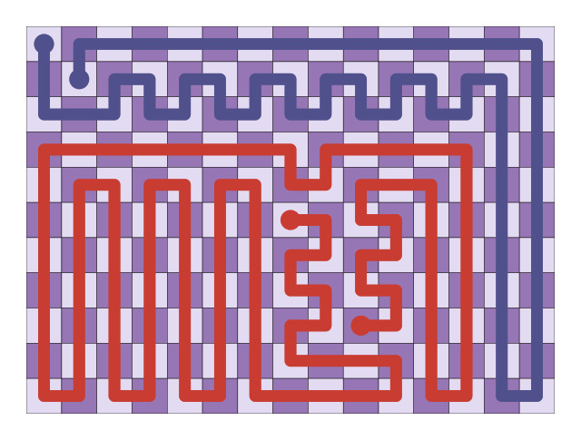

# Two-colour Zig-Zag Numberlink on rectangles



Decide and solve two-colour Zig-Zag Numberlink (the paired 2-disjoint path cover problem) on
rectangular grids: given an R × C grid and endpoints s0, t0 (colour 0) and s1, t1 (colour 1), find
two vertex-disjoint paths s0 → t0 and s1 → t1 that together visit every cell, or show that none
exists.

For both sides at least 11, an instance is solvable if and only if none of a finite catalogue of
forbidden patterns occurs; for a side at most 10, a plug dynamic programming algorithm decides it.
Solutions are constructed in polynomial time. Lean 4 verifies both directions of the characterization,
the correctness of the decision procedure and of the construction, and polynomial bounds on the
number of steps of both. The kernel checks every proof: the results depend only on `propext`,
`Classical.choice` and `Quot.sound`. The constants in the step bounds are
astronomically large.

| Path | Contents |
|---|---|
| [`paper/`](paper/) | The paper (LaTeX; `make` builds `build/zzn.pdf`) |
| [`docs/`](docs/) | The proof in prose ([`PROOF.md`](docs/PROOF.md)), the algorithm ([`ALGORITHM.md`](docs/ALGORITHM.md)) and the plug DP ([`PLUGDP.md`](docs/PLUGDP.md)), with figures |
| [`lib/`](lib/) | Libraries and command-line programs in Python, JavaScript and C |
| [`proof/`](proof/) | The kernel-checked Lean 4 proof, a self-contained Lake project ([`proof/README.md`](proof/README.md)); also the Palomar registry entry |
| [`certgen/`](certgen/) | The certificate search and the certificates the proof checks |
| [`LICENSE`](LICENSE) | CC0 1.0 Universal |

## Quick start

```bash
python3 lib/python/zzn_cli.py 12 12 0 0 0 11 11 0 11 11 --grid
```

The arguments are R, C and the endpoints s0, t0, s1, t1 as row-column pairs. The JavaScript
(`node lib/js/cli.js ...`) and C (`make -C lib/c && lib/c/zzn ...`) programs take the same
arguments and print the same output; see [`lib/README.md`](lib/README.md).

## How to verify

The results rest on the Lean proof in [`proof/`](proof/). To check them:

1. **Install Lean** with [elan](https://github.com/leanprover/elan). The toolchain is pinned in
   `proof/lean-toolchain` (Lean v4.35.0-rc2) and Mathlib in `proof/lake-manifest.json`.
2. **Build**, from `proof/`:

   ```bash
   lake exe cache get
   LEAN_NUM_THREADS=2 lake build Results Challenge Solution
   ```

   `lake exe cache get` downloads a prebuilt Mathlib. A clean build takes about 5.4 CPU-hours
   (2.6 hours with two Lean processes) and up to about 13 GB of memory per process.
3. **Check the axioms**, from `proof/`:

   ```bash
   lake env lean Axioms.lean
   ```

   Expected: every main result depends only on `propext`, `Classical.choice` and `Quot.sound`.
4. **Read the statement.** `proof/ZZN/Statement.lean` (759 lines, imports only Mathlib) defines
   instances, paths and solutions, the forbidden-pattern catalogue, the decision procedure
   `solvableB` and the construction `solveZZN`. The main theorems are `solvableB_iff`
   (`ZZN/Thin/Decide.lean`), `passes_iff_solvable` (`ZZN/Main.lean`) and `solveZZN_sound` /
   `solveZZN_complete` (`ZZN/Constr/Main.lean`). Everything else is checked by Lean against these
   definitions, so these are the parts a reader has to trust, together with Lean and Mathlib's
   axioms. The Palomar registration (`proof/Challenge.lean`) states the same results on the
   procedures with a step counter, with their step bounds: `solvableBT_main`,
   `fires3T_iff_solvable` and `solveZZNT_main`, using `proof/ZZN/TimedStatement.lean`.

The finite cases of the characterization are certificates checked by the kernel: 21 boxes of
slice certificates (Theorem A) and the window certificates of Theorem B. [`certgen/`](certgen/)
holds the program that found them; it is not trusted, since a wrong certificate fails the build.

## [Demo](https://zzyzek.github.io/R2K2ZZN/demo/)

There is a rudimentary [web application](https://zzyzek.github.io/R2K2ZZN/demo/)
demonstrating solutions on small instances.

## AI disclosure

Nearly the entirety of the work for this project was done by Claude (Opus 5.5), including writing
the paper, the reference implementations and the Lean 4 proof. The author contributed little more
than the problem statement and guidance.

## License

To the extent possible under law, the author has waived all copyright and related or neighboring
rights to this work: the paper, the source code, the Lean proofs, the documentation and the data.
This work is published under the [CC0 1.0 Universal](https://creativecommons.org/publicdomain/zero/1.0/)
public domain dedication; see [`LICENSE`](LICENSE). Source files carry the SPDX identifier
`CC0-1.0`.
