# Two-colour Zig-Zag Numberlink on rectangles: the algorithm

This page describes the decision procedure and the construction that the Lean proof in
[`proof/`](../proof/) defines and proves correct, and that the libraries in [`lib/`](../lib/)
(Python, JavaScript, C) implement. Each step names the Lean definition or theorem it comes from,
as `file:line` under `proof/` at commit 31c6bb0. The low-level details are in those definitions. The dynamic program
for thin rectangles has its own page, [PLUGDP.md](PLUGDP.md).

## 1. The problem

An **instance** is a w × h grid of cells (x, y), 0 ≤ x < w, 0 ≤ y < h, with four distinct
**endpoints**: s0, t0 of colour **A** and s1, t1 of colour **B** (`Inst`, `ZZN/Statement.lean`).
The libraries write a cell as (r, c) on an R × C grid, with r = x, R = w, c = y, C = h. A
**solution** is two paths, s0 → t0 and s1 → t1, each a sequence of distinct edge-adjacent cells,
that share no cell and together visit every cell (`IsSolution`).

| 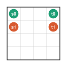 | 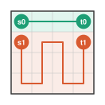 |
|---|---|

Lean proves the following for well-formed instances (four distinct endpoints inside the grid).

- **Decision.** If both sides are at least 11, the instance is solvable exactly when no entry of a
  finite catalogue of patterns fires (§3; `passes_iff_solvable`, `ZZN/Main.lean:23`). Otherwise
  the plug DP algorithm decides it (§4). The counted procedure `solvableBRT` answers correctly
  within CdecR · (w h + w + h + 1) steps (`solvableBRT_main`, `ChallengeDecide.lean:790`).
- **Construction.** `solveZ3 (leafL thinSolveW2 tabAll)` returns a solution exactly when one
  exists (`solveZ3L_main`, `ZZN/Look/Main.lean:24`). Its counted version takes O(M²) steps,
  M = max(w, h), with the constants in §9 (`solveZ3LT_main`, `ZZN/Look/RoundTimeL.lean:97`).
  §5–§7 describe this construction.

The construction prepared for Palomar registration (not yet submitted), `solveZ3RT_main`
(`ChallengeConstruct.lean:894`), is the same construction with the plug DP algorithm as the leaf solver, and has a larger constant.

## 2. Terms

- **Thin:** a side is at most 10.
- **Line:** a full row (fixed x) or column (fixed y). A line is **free** if it holds no endpoint.
  An **endpoint line** holds an endpoint.
- **Deleting lines d, d + 1** of an axis removes them and moves the cells after them back by 2
  (`Inst.deleteAt`, `ZZN/Statement.lean`).
- **Transposed:** x and y swapped. The construction tries each kind of deletion on the x-axis
  first, then on the transposed instance, and continues in the transposed frame.
- **Leaf:** the instance left when no further deletion applies. It is solved directly (§7).
- **Endpoints and path colours:** s0, t0 have path colour 0 (A) and s1, t1 have path colour 1 (B).
  Lean lists them as `[(s0, 0), (t0, 0), (s1, 1), (t1, 1)]` (`ZZN/Statement.lean:378`). For a path
  colour a, ā is the other path colour (`1 - a` in Lean).
- **Well formed:** The four endpoints are distinct cells of the grid (`Inst.WellFormed`,
  `ZZN/Statement.lean:67`).
- **Domain 𝔇:** Both sides at least 11 and the instance well formed (`InDom`,
  `ZZN/Skeleton.lean:37`).
- **Cell parity and σ:** A cell (r, c) is black if r + c is even and white otherwise.
  σ = +1 on black cells and −1 on white cells (`sgn`, `ZZN/Statement.lean:153`).
- **Border:** The cells of row 0, row R − 1, column 0 and column C − 1. The **clockwise order**
  on the border starts at (0, 0) and runs along row 0 to the right, down column C − 1, along row
  R − 1 to the left and up column 0 (`perimIndex`, `ZZN/Statement.lean:157`).
- **Empty cell:** A cell that holds no endpoint.
- **Alternating:** Four path colours in a given order alternate when each one differs from the
  next (`alternating`, `ZZN/Statement.lean:163`). With two endpoints of each colour this is the
  order 0 1 0 1 or 1 0 1 0.
- **Corner frame:** One of 8 coordinate systems, a triple (row flip, column flip, transpose)
  (`Frame`, `frames`, `Frame.to`, `ZZN/Statement.lean:123–141`). Frame cell (0, 0) is a grid
  corner, the top-left one with no flips, column flip moves it to the right, row flip to the
  bottom. Without transpose, frame cell (i, j) lies i rows and j columns from that corner; with
  transpose, i columns and j rows. Frame row 0 is a row of the grid (no transpose) or a column of
  the grid (transpose). Frame height H is R without transpose and C with it, frame width W the
  other side. Each corner has two frames, one per transpose value. `frames` lists them with row
  flip as the slowest bit and transpose as the fastest.

## 3. The catalogue

`fires3 R C s0 t0 s1 t1` (`ZZN/Statement.lean:377`) is a single Boolean, the OR of the entries
below. It is defined for every R and C. Listed in the order of `fires3`.

What the proof states about it:

- **Characterization.** For a well-formed instance with both sides at least 11, `fires3` is false
  exactly when the instance is solvable (`passes_iff_solvable`, `ZZN/Main.lean:23`, with
  `Passes`, `ZZN/Statement.lean:385`). The form prepared for Palomar is `fires3T_iff_solvable`
  (`ChallengeDecide.lean:797`, proved at `ZZN/Timed/Main.lean:95`). Its `fires3T` returns the
  value of `fires3` (`fires3T_ret`, `ZZN/Timed/Catalogue.lean:217`) and adds a step count.
- **Thin grids.** No theorem relates `fires3` to solvability when a side is at most 10. Thin
  instances are decided by the plug DP.
- **Per-entry soundness** (the entry fires ⇒ no solution). The lemmas and their hypotheses are
  listed with each entry. Theorem B (`ZZN/TheoremB.lean:63`, discharged as `WinKU.theoremB_K`,
  `WinKU/Facts.lean:170`) combines them on 𝔇.
- **Symmetry.** On 𝔇, passing is unchanged by swapping s0 with t0, by swapping s1 with t1, and by
  swapping the path colours (`passes_rev0`, `passes_rev1`, `passes_swapColors`,
  `ZZN/PassSym.lean:853–866`), and by transposing the grid (`passes_transpose_iff`,
  `ZZN/Orbit.lean:274`). For the row and column flips no theorem about `fires3` is stated; the
  invariance follows from `passes_iff_solvable` and `solvable_frameMap`
  (`ZZN/SoundLocal.lean:31`). The entries themselves need no added symmetric copies. P, T1, T2,
  L1 and L6 are written symmetrically, and the corner entries are evaluated in all 8 frames with
  a colour variable a.

The entry names P, T1, … are those of the Lean comments (section headings of `ZZN/Catalogue.lean`,
`ZZN/TheoremB.lean:14–21`, `ZZN/Statement.lean:262–272`). The Python library
(`lib/python/zzn/catalogue.py`) reports C and D both as `C4`.

### Global entries

| | Lean | Fires when | Soundness lemma |
|---|---|---|---|
| **P** | `!parityOk`, `Statement.lean:154` | Σ σ over the four endpoints ≠ 2·(RC mod 2) | `parityOk_of_solvable`, `Parity.lean:157`, no size condition |
| **T1** | `t1Fires`, `Statement.lean:296` | all four endpoints on the border, and their path colours alternate in clockwise order | `t1_sound`, `SoundT1.lean:538`, well formed, R, C ≥ 2 |
| **T2** | `t2Fires`, `Statement.lean:300` | the endpoints occupy two adjacent rows and two adjacent columns, and s0, t0 differ in both row and column; so the four endpoints fill a 2 × 2 square with each path colour on a diagonal | `t2_sound`, `SoundT2.lean:334`, well formed |
| **L1** | `l1Fires`, `Statement.lean:307` | some endpoint has every in-grid neighbour occupied by an endpoint of the other path colour | `l1_sound`, `SoundLocal.lean:707`, well formed |
| **L6** | `l6Fires`, `Statement.lean:314–325` | both path colours have a **closed corner**, and RC > 6. A corner of the grid is closed by path colour a when the corner cell is empty and its row neighbour and column neighbour are both endpoints of colour a | `l6_sound`, `SoundLocal.lean:767`, R, C ≥ 2 |

### Corner entries

`frames.any (frameFires R C pts)` (`Statement.lean:326`). In each of the 8 corner frames the
endpoints are read in frame coordinates (`makeView`, `Statement.lean:151`), and the frame fires
when one of the following holds. a is either path colour.

| | Lean | Fires when (frame cells) |
|---|---|---|
| **L2** | `testL2`, `Statement.lean:173` | (0,1) and (1,0) hold endpoints of different colours; (0,0) empty |
| **L3** | `testL3`, `Statement.lean:177` | (0,2) and (1,1) hold colour a, (1,0) holds ā; (0,0), (0,1) empty |
| **L4** | `testL4`, `Statement.lean:181` | (0,0) and (1,1) hold colour a, (0,2) holds ā; (0,1), (1,0) empty; H ≥ 3 |
| **L5** | `testL5`, `Statement.lean:186` | (0,0) holds a, (0,2) and (2,0) hold ā; (0,1), (1,0), (1,1) empty |
| **E1** | `edgeClosure`, `Statement.lean:221` | for some k with k + 3 < W, (0,k) and (1,k+1) hold a, (1,k+2) and (0,k+3) hold ā |
| **B** | `boundaryOnly`, `Statement.lean:239` | for a listed triple (p, q, b), p and q hold a, b holds ā, and the other ā endpoint lies on the border and outside frame rows 0–5 × columns 0–5. The list is `BOUNDARY3_ODD` when R and C are both odd and `BOUNDARY3_EVEN` otherwise |
| **C** | `corner4`, `Statement.lean:216` | R ≥ 10, C ≥ 10, RC even, and the set of colour-0 endpoints and the set of colour-1 endpoints are the two pairs of a configuration in `CORNER4`, in either assignment |
| **D** | `corner4`, `Statement.lean:216` | as C, with RC odd and the list `CORNER4_ODD` |

The conditions R ≥ 10 and C ≥ 10 for C and D are in `frameFires` (`Statement.lean:328`).

Soundness. In the identity frame L2–L5 and E1 are sound for any well-formed instance
(`testL2_sound` … `testL5_sound`, `edgeClosure_sound`, `SoundLocal.lean:360, 395, 426, 477, 634`).
All frames on 𝔇 are covered by `frames_sound` (`TheoremB.lean:39`). B, C and D are sound for both
sides at least 11, from the window certificates (`BFacts`, `TheoremB.lean:27`, discharged by
`certFactsK`, `WinKU/Facts.lean:167`).

The lists, cells written as `ij` = frame cell (i, j). They equal the Lean lists entry by entry and
in order (`Statement.lean:191–213, 228–238`).

- **B, `BOUNDARY3_EVEN`** (21 triples p q b): (00 11 12), (01 02 11), (01 02 12), (01 03 11),
  (01 04 11), (01 04 12), (01 05 11), (01 12 11), (01 12 13), (01 12 22), (01 12 31), (01 13 03),
  (01 21 13), (01 21 22), (01 21 31), (02 21 10), (03 11 10), (04 11 10), (04 21 10), (04 21 12),
  (05 11 10).
- **B, `BOUNDARY3_ODD`** (5): (00 11 12), (00 11 22), (01 02 11), (01 04 11), (04 11 10).
- **C, `CORNER4`** (36), as {pair | pair}: {01 03 | 11 13}, {01 06 | 07 11}, {01 06 | 11 70},
  {01 06 | 12 60}, {01 07 | 11 60}, {01 13 | 11 12}, {01 13 | 12 22}, {01 13 | 12 31},
  {01 22 | 11 12}, {01 22 | 12 31}, {01 22 | 13 30}, {01 70 | 11 60}, {02 11 | 21 30},
  {02 20 | 12 21}, {03 21 | 31 40}, {06 21 | 12 60}, {12 22 | 13 21}, {12 31 | 13 21},
  {01 12 | 04 22}, {01 12 | 04 31}, {01 12 | 13 20}, {01 12 | 13 40}, {01 12 | 20 22},
  {01 12 | 22 40}, {01 12 | 31 40}, {01 13 | 03 04}, {01 13 | 03 20}, {01 13 | 03 40},
  {01 21 | 02 22}, {01 21 | 02 31}, {01 21 | 04 13}, {01 21 | 04 22}, {01 21 | 04 31},
  {01 21 | 13 40}, {01 21 | 22 40}, {01 21 | 31 40}.
- **D, `CORNER4_ODD`** (3): {00 01 | 11 20}, {00 14 | 02 13}, {00 23 | 02 13}.

### R: forced corner rewrites, then alternation along the new border

`effAlt3` (`Statement.lean:366`). It works on **effective endpoints**, a copy of the four
endpoints with their path colours, and a set of **settled cells**, initially empty.

**Rewriting** (`rewriteAll`, `rwStep`, `rewritesAt`, `Statement.lean:260–295`). The 8 frames are
visited in the order of `frames`. In each frame the effective endpoints are read in frame
coordinates and the first of R3, R2, R1 whose pattern matches is selected. The frame is skipped
when no pattern matches, when a cell the rule would settle is already settled, or when a move
target is already settled; a blocked rule does not fall through to the next rule. Otherwise the
moves are applied to the effective endpoints and the rule's cells are added to the settled set.

| Rule | Pattern (frame cells) | Settled cells | Moves |
|---|---|---|---|
| **R3** | (1,2), (2,1) hold endpoints of different colours; (0,0), (0,1), (0,2), (0,3), (1,0), (1,1), (2,0), (3,0) empty; H ≥ 4, W ≥ 4 | the 3 × 3 corner block except (2,2) | (1,2) → (0,3), (2,1) → (3,0) |
| **R2** | (0,0), (1,1) hold the same colour; (0,1), (1,0), (0,2), (2,0) empty; H ≥ 3, W ≥ 3 | (0,0), (0,1), (1,0), (1,1) | (0,0) → (0,2), (1,1) → (2,0) |
| **R1** | (0,1) holds an endpoint; (0,0), (1,0) empty; H ≥ 2 | (0,0), (0,1) | (0,1) → (1,0) |

Every rule settles frame cell (0,0), the grid corner, so at each corner at most one of its two
frames applies a rule.

**The walk** (`walk3`, `Statement.lean:345`, with `notchLen`, `staircase`, `stairOf`,
`Statement.lean:331–344`). A list of cells in clockwise order starting at the top-left corner. It
consists of row 0, column C − 1, row R − 1 and column 0, except that each corner is replaced by a
**staircase** around that corner's settled cells. In the corner's untransposed frame, let λᵢ be the
number of settled cells among frame cells (i,0)…(i,3), for i = 0…3, and k the number of rows i
with λᵢ > 0. The staircase runs from frame cell (k, 0) in column 0 to frame cell (0, λ₀) in row 0,
through the cells just below and just to the right of the settled block, including the cells
that touch it only at a corner. For R2, for example, it is (2,0), (2,1), (2,2), (1,2), (0,2). A corner with no
settled cells contributes only its corner cell. With no settled cells at all the walk is the
border in the clockwise order of T1. No theorem in `Statement.lean` states that `walk3` is the
boundary of the grid minus the settled cells; that reading is from the definition.

**Fires when** all of the following hold (`effAlt3`):
1. at least one rule was applied;
2. no effective endpoint lies on a settled cell;
3. the four effective endpoints are on four distinct cells;
4. each effective endpoint's cell occurs exactly once in the walk;
5. the path colours of the effective endpoints alternate in walk order.

Soundness. `r_sound` (`SoundRMain.lean:334`), on 𝔇.

### Figures

| 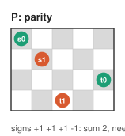 | 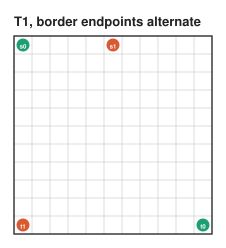 | 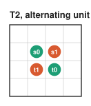 | 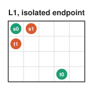 |
|---|---|---|---|
| 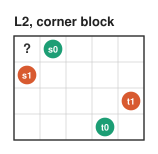 | 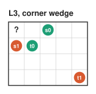 | 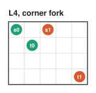 | 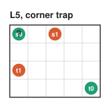 |
| 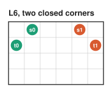 | 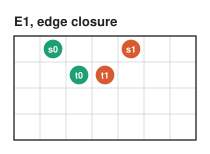 | 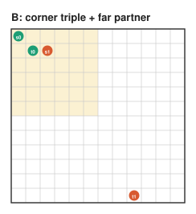 | 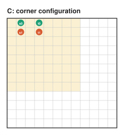 |
| 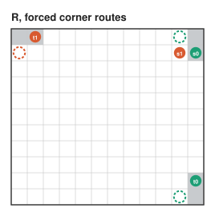 | | | |

Generated by `docs/figures/make_figures.py` from the Python library. The figure instances
were evaluated with the Lean entries (all 13 agree with Python), except the 11 × 11 instance of
T1 (added 2026-11-17), which was evaluated in Python only. The grids of P and T2–E1 are 4 × 4 to
4 × 7, outside 𝔇.

| Figure | Depicts the entry | Other entries that also fire on the figure's instance |
|---|---|---|
| `cat_P.svg` | P, correct (sum 2, needs 0) | none |
| `cat_T1.svg` | T1, correct, 11 × 11 | none (Python) |
| `cat_T2.svg` | T2, correct | none |
| `cat_L1.svg` | L1, correct pattern | T1 (listed first), R |
| `cat_L2.svg` | L2, correct pattern | T1 (listed first) |
| `cat_L3.svg` | L3, correct | R |
| `cat_L4.svg` | L4, correct pattern | P (listed first) |
| `cat_L5.svg` | L5, correct pattern; the "?" mark is drawn over s0 at (0,0) | P (listed first), T1, R |
| `cat_L6.svg` | L6, correct | none |
| `cat_E1.svg` | E1, correct | none |
| `cat_B.svg` | B, triple (00 11 12), other B endpoint on row 11; shaded 6 × 6 window correct | R |
| `cat_C.svg` | C, configuration {01 03 \| 11 13}; the 8 × 8 shading is illustrative, `corner4` has no window | none |
| `cat_R.svg` | R, correct (grey = settled, dashed = moved effective endpoints), 11 × 12 | none |
| missing | D (RC odd); the R rule table (R1, R2, R3 patterns) | |

### Implementations against Lean

`lib/tests/lean_catalogue.py` evaluates `fires3` and each of its entries in Lean
(`lib/tests/lean/CatEval.lean`) and compares them with the Python catalogue. On 100,000 instances
(seed 2) the results agree on every instance, for `fires3` and for every entry. JavaScript and C
are compared with Python by `lib/tests/compare.py`.

## 4. Thin instances: the plug DP algorithm

When a side is at most 10, a dynamic program over the cells decides the instance and builds a
solution. Its states are the frontiers of partial paths across the short side, and its time is
linear in the long side. The libraries use their own plug DP ([PLUGDP.md](PLUGDP.md)). The Lean
proof uses `thinSolveW2` (`ZZN/Constr/ThinWit2.lean`) and its counted form `thinSolveWRT`. Both are
exact.

## 5. Blocks: delete 2k free lines at once

The outer layer of the construction is `solveR` (`ZZN/Constr/Round.lean:420`). A **block** is 2k
free lines of one axis, deleted at once. On an axis of length n, with xmin and xmax the smallest and
largest endpoint lines (subtraction stops at 0):

| Block | Lines deleted | k |
|---|---|---|
| left | 0 … 2k − 1 | min(⌊(xmin − 2)/2⌋, ⌊(n − 11)/2⌋) |
| right | n − 2k … n − 1 | min(⌊(n − 3 − xmax)/2⌋, ⌊(n − 11)/2⌋) |
| inner | r + 1 … r + 2k, where r = a + 1 for endpoint lines a < b with no endpoint line between them | min(⌊(b − a − 9)/2⌋, ⌊(n − 11)/2⌋) |

The first block with k ≥ 1 is taken, in the order left, right, inner, with the pairs (a, b) in
endpoint order (`blkX`, `Round.lean:290`). The x-axis is tried first, then the transposed
instance. Deletion stops when a side is at most 10 or no block is left on either axis. The cap
⌊(n − 11)/2⌋ keeps both sides at least 11.

Lean proves three bounds:
- **At most 36 blocks** in all (`phi_le`, `phi_del`, `ZZN/Constr/RoundCount.lean`).
- **Sides at most 37 at the end** (`w_le_of_none`): at most 3 free lines at each edge, and at
  most 9 between adjacent endpoint lines (4 endpoint lines + 3 + 3 + 3 · 9 = 37).
- **Passing is kept:** each block deletion is a chain of `RedX` deletions (`Chain`), so the
  remaining instance passes the catalogue whenever the original does (`chain_pass`,
  `Round.lean:32`).

The remaining instance is solved by §6 and §7. Each block is then put back by one lift, a single
pass over the paths. `blkX_ok` (`Round.lean:344`) proves the lift gives a solution.

- **Edge block** (`edgeLift`, `ZZN/Constr/EdgeBlock.lean:374`). Take the first step u → v of a
  path (A first, then B) along the last line n − 1. Such a step exists when the other side is at
  least 5. Splice a snake between u and v. From u it covers the new lines on u's side of the step,
  walking k pairs of lines, and then returns over v's side to v. A left block is the same after a
  reflection (`edgeLiftL`, `EdgeBlock.lean:572`).

| 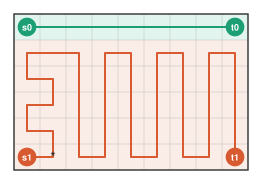 | 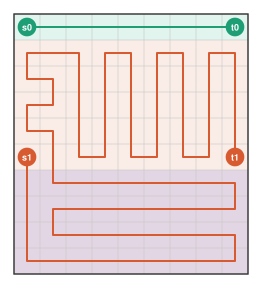 |
|---|---|

- **Inner block** (`innerLift`, `Round.lean:212`; the wide band `wideExt`,
  `ZZN/Constr/WideBand.lean:300`). Insert 2k lines after line r. Where a path crosses between
  lines r and r + 1 at position y, it detours through the new lines. The detour is a snake over y
  and over the positions attached to y: the run of positions up to the next crossing, on the side
  away from a **seed** boundary R. The seed (`seedW`, `Round.lean:202`) is the first boundary R,
  between positions R − 1 and R, that satisfies one of two conditions:
  - both neighbours of the boundary are crossings or the border;
  - a path steps along line r between R − 1 and R, and neither position is a crossing.

  In the second case that step is replaced by a **flip block** over both runs.

| 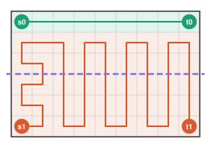 | 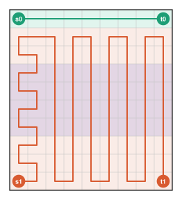 |
|---|---|

## 6. Two-line reductions

On what the blocks leave, `solveRec2` (`ZZN/Constr/Solve2.lean:214`) deletes two free lines
d, d + 1 at a time. It takes the first d in 0, 1, … for which `RedX` or `RedB` holds (`findRed2`,
`Solve2.lean:186`), on the x-axis first and then on the transposed instance. Both need the axis to
have length at least 13.

`RedX` (`ZZN/Skeleton.lean:50`) holds when one of four clauses does:
- **Strip:** d = 0 and lines 0–3 are free.
- **Right strip:** d = n − 2 and the last 4 lines are free.
- **Compression:** 10 consecutive free lines lo … lo + 9 have an endpoint line before and after
  them, and d, d + 1 lie among them.
- **Interior compression:** 8 ≤ d ≤ n − 10, lines d, d + 1 are free, line d − 1 or d + 2 is free,
  and there is an endpoint line before d and after d + 1.

`RedB` (`ZZN/PassB.lean:29`; decided by `redBB`, `Solve2.lean:163`) is the band compression:
5 ≤ d ≤ n − 7, lines d, d + 1 are free, line d − 1 or d + 2 is free, and there is an endpoint line
before d and after d + 1.

Each figure shows one clause, with d, d + 1 dark. `findRed2` takes the first d that satisfies any
clause. In the compression example that is d = 4. In the interior-compression example it is
`RedB` at d = 5.

| 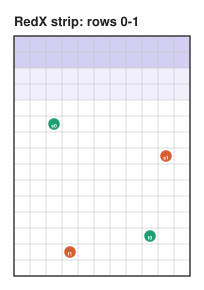 | 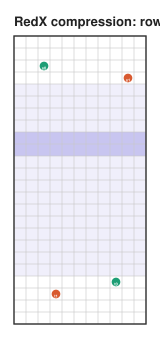 | 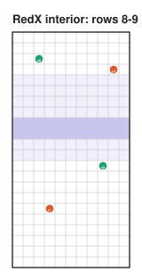 | 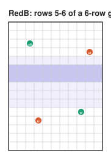 |
|---|---|---|---|

A deletion keeps the instance passing the catalogue (`passX_all`, `PassB.lean:181`, for `RedX`;
`passB`, `PassB.lean:118`, for `RedB`). Deletions stop when a side is at most 10 or neither
reduction applies on either axis. Then, if both sides are at least 11, both are at most 16
(`leaf16`, `Solve2.lean:272`).

The lines are put back by **band extension** (`liftE`, `ZZN/Statement.lean:510`; correct by
`liftE_solF`, `Solve2.lean:46`). It inserts two lines after line d of the smaller instance if
d + 3 ≤ n and line d + 2 of the larger instance is free, else after line d − 1. Inserting two lines
after a free line r (`bandExtE`, `Statement.lean:432`) works in four steps:
1. Every path step that crosses between lines r and r + 1 is stretched through the two new lines
   (`stretch`).
2. A seed boundary R is chosen as for the inner block in §5 (`SeedAt`).
3. In the second seed case, the path step along line r between R − 1 and R is replaced by a
   4-cell detour through the new lines (`flipE`).
4. Each remaining new position y is covered by a detour of the new-line step at the neighbouring,
   already covered position, sweeping away from R in both directions (`absorbE`, `sweepLeftE`,
   `sweepRightE`).

|  | 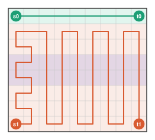 |
|---|---|

## 7. The leaf

The leaf solver is `leafL` (`ZZN/Look/Complete.lean:141`). If a side is at most 10, the leaf goes
to the plug DP algorithm (§4). This happens only for instances that are thin from the start,
because blocks and reductions keep both sides at least 11. Otherwise the leaf has both sides 11–16
and no reduction on either axis. The certificate lookup `lookJ tabAll` (`ZZN/Look/Leaf.lean:141`)
answers it in four steps:
1. **Orientation.** If w > h, the leaf is transposed first.
2. **Canonical form.** A **symmetry** combines up to six operations: transpose, reflect the
   x-axis, reflect the y-axis, swap s0 with t0, swap s1 with t1, and swap the colours (`Sym`,
   `ZZN/Moves.lean:173`). There are 64 symmetries (`allSym`) on a square box, and 32 without
   transposition on other boxes (`Gbox`, `ZZN/BoxK/Box.lean:54`). The leaf is mapped by the first
   symmetry with the least key `key2` (`Box.lean:94`, from the endpoint rows, then the endpoint
   columns). The result K is the canonical form (`lookLe`, `Leaf.lean:136`).
3. **Slice.** The table `tabAll w h` (`ZZN/Look/Table.lean:64`) is a list of **slices**, each for
   a row tuple, the x-coordinates of s0, t0, s1, t1. `lookK` takes the first slice with K's row
   tuple.
4. **Entry.** `entryP` (`Leaf.lean:46`) tries the slice's **template pairs** in order. A pair is a
   template T and a symmetry τ. The first pair for which T checks on τ(K) (`tcheck`,
   `ZZN/Cut/Template.lean:68`) gives the solution `tsol T (τ K)` (`ZZN/Look/Build.lean:428`),
   mapped back by τ and then by the canonical symmetry (`unSym`, `ZZN/Look/Sym.lean:137`). If no
   pair checks, the slice's **stored solution** for K's column tuple is decoded (`decPath`) and
   checked (`solF`, `ZZN/Cut/SolF.lean`).

A **template** is a cut tree (`CTree`, `ZZN/Cut/Tree.lean:46`). A cut splits a rectangular piece
along a row or a column, at a position given as an anchor plus an offset. The anchors are the
endpoint coordinates on that axis, 0, and the side length (`posN`, `Template.lean:66`). For each
endpoint pair of the piece, the cut says one of three things (`Kind`):
- both ends stay on one side;
- the path crosses at a given cell;
- the path leaves at one cell and returns at another, so that the other side gets a new pair.

A leaf of the tree holds one pair. It is either a single cell, or a rectangle that has a
Hamiltonian path between the pair by the criterion of Itai, Papadimitriou and Szwarcfiter (`accB`,
`ZZN/Cut/LaneV.lean:336`). `tsol` builds those paths (`ipsP`, `ZZN/Look/IPS.lean:402`) and joins
them across the cuts (`buildT`).

| 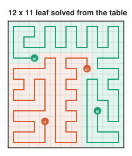 | 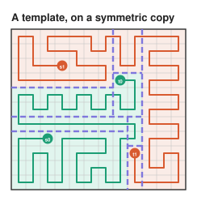 |
|---|---|

The first figure is the leaf of §8 with its solution. The second is the template that answers it,
drawn on the symmetric copy τ(K) where it is checked.

**The table** has 21 boxes, w × h with 11 ≤ w ≤ h ≤ 16. It holds 16,477 slices, 255,545 template
pairs over 11,029 templates (8,660 of them used), and 8,444 stored solutions. It is generated from
the certificate modules in `proof/BoxKGen/` and `proof/ZZN/LookGen/`. Lean checks that the table is
certified (`tabAll_ok`, `Table.lean:67`). The lookup then answers every well-formed passing leaf
with sides 11–16 and no reduction on either axis (`lookJ_complete`, `Leaf.lean:306`), and every
answer is a solution (`lookJ_sound`, `Leaf.lean:157`). The libraries read the table from
`lib/data/look.json.gz`, exported from the Lean sources by `lib/tools/export_look.py`.

## 8. A worked example

A 16 × 13 instance that passes the catalogue.

| 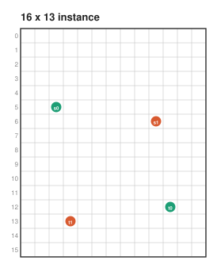 | 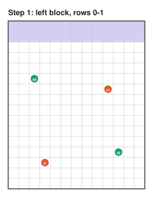 |
|---|---|

1. **Left block.** The smallest endpoint row is 5, so k = min(⌊(5 − 2)/2⌋, ⌊(16 − 11)/2⌋) = 1, and
   rows 0, 1 are deleted (§5). The instance becomes 14 × 13, with endpoint rows 3, 4, 10, 11. No
   block is left on either axis.
2. **RedB, rows 5–6.** The 14 × 13 instance has no `RedX`:
   - rows 0–3 are not all free, and neither are rows 10–13;
   - at most 5 free rows lie between endpoint rows;
   - interior compression needs d ≥ 8 and d + 10 ≤ 14.

   `RedB` holds at d = 5: rows 5 and 6 are free, row 7 is free, and there are endpoint rows before
   and after. The instance becomes 12 × 13.
3. **RedB, columns 5–6.** With 12 rows, no row reduction applies, because reductions need length at
   least 13. On the transposed instance, `RedB` holds at d = 5, for columns 5 and 6. The instance
   becomes 12 × 11 in the original orientation.
4. **Leaf.** 12 × 11 admits no reduction. The lookup answers it with a template pair (§7).
5. **Lift back.** Band extension puts back columns 5, 6, then rows 5, 6. The edge lift puts back
   rows 0, 1.

| 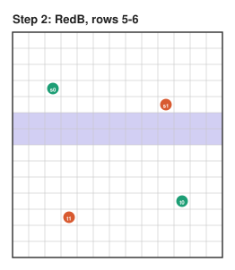 | 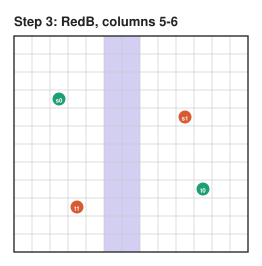 | 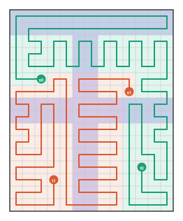 |
|---|---|---|

Run it: `python3 lib/python/zzn_cli.py 16 13 5 2 12 10 6 9 13 3 --grid --trace`.

## 9. Cost

`solveZ3LT_main` bounds the counted construction by

  37 (80 (M + 1)² + 400) + (10 M + 1) · KwR 10 + 3 (10 M + 1)² + 10 + B

steps, with M = max(w, h) and the constant

  B = 74 · 700 · 38² + (371 · KwR 10 + 28,000,000) + 3 · 593² + 10.

- The first term covers at most 37 rounds of block deletion and lifting (36 blocks and the last
  round), each at most 80 (M + 1)² + 400 steps.
- The (10 M + 1) terms cover a leaf with a side at most 10, at most 10 M cells, by the plug DP
  algorithm at KwR 10 steps per cell.
- B covers the work on the instance left by block deletion, with sides at most 37: the two-line
  reductions and lifts, and its leaf.

KwR 10 is defined in `ZZN/Timed/ThinRopeCost.lean`. The decision procedure takes at most
CdecR (w h + w + h + 1) steps, with CdecR = KwR 10 + 300,000 (`ChallengeDecide.lean:784`).

The libraries are not counted in Lean, and no running-time bound is proved for them. They follow
the same steps, and their measured times grow about as w h when both sides are at least 11 and
linearly in the long side for thin instances ([`lib/README.md`](../lib/README.md)).

## 10. Why it is correct

| Statement | Lean |
|---|---|
| Passing ⇔ solvable, both sides ≥ 11 | `passes_iff_solvable`, `ZZN/Main.lean:23` |
| The counted decision procedure is correct, with its step bound | `solvableBRT_main`, `ChallengeDecide.lean:790` |
| The counted catalogue ⇔ solvable, both sides ≥ 11 | `fires3T_iff_solvable`, `ChallengeDecide.lean:797` |
| Block deletion keeps passing; each block lift gives a solution | `chain_pass`, `blkX_ok`, `ZZN/Constr/Round.lean:32, 344` |
| `RedX` and `RedB` keep passing | `passX_all`, `passB`, `ZZN/PassB.lean:181, 118` |
| Band extension gives a solution | `liftE_solF`, `ZZN/Constr/Solve2.lean:46` |
| A leaf with both sides ≥ 11 has both sides ≤ 16 | `leaf16`, `Solve2.lean:272` |
| The lookup is sound and complete on leaves | `lookJ_sound`, `lookJ_complete`, `ZZN/Look/Leaf.lean:157, 306` |
| The table is certified | `tabAll_ok`, `ZZN/Look/Table.lean:67` |
| The construction is sound and complete | `solveZ3L_main`, `ZZN/Look/Main.lean:24` |
| Its step bound | `solveZ3LT_main`, `ZZN/Look/RoundTimeL.lean:97` |

The libraries transcribe these definitions. The block layer, the reductions and the lookup are
compared with the Lean definitions evaluated in Lean on the libraries' own data
(`lib/tests/lean_blocks.py`, `lean_reduce2.py`, `look_lean.py`). That is a test, not a proof that
the library code equals the Lean code. Every solution the libraries return is checked before it
is returned.

## 11. Where to look

| | |
|---|---|
| Implementations | `lib/python/zzn` (`blocks.py`, `reduce2.py`, `look.py`, `catalogue.py`, `plugdp.py`), `lib/js/zzn.js`, `lib/c` |
| Plug DP | [PLUGDP.md](PLUGDP.md) |
| Lean | `proof/README.md` |
| Figures | `docs/figures/make_figures.py` regenerates every figure from the Python library |

## License

CC0 1.0 Universal: to the extent possible under law, the author has waived all copyright and
related or neighboring rights to this work. See [`LICENSE`](../LICENSE).
